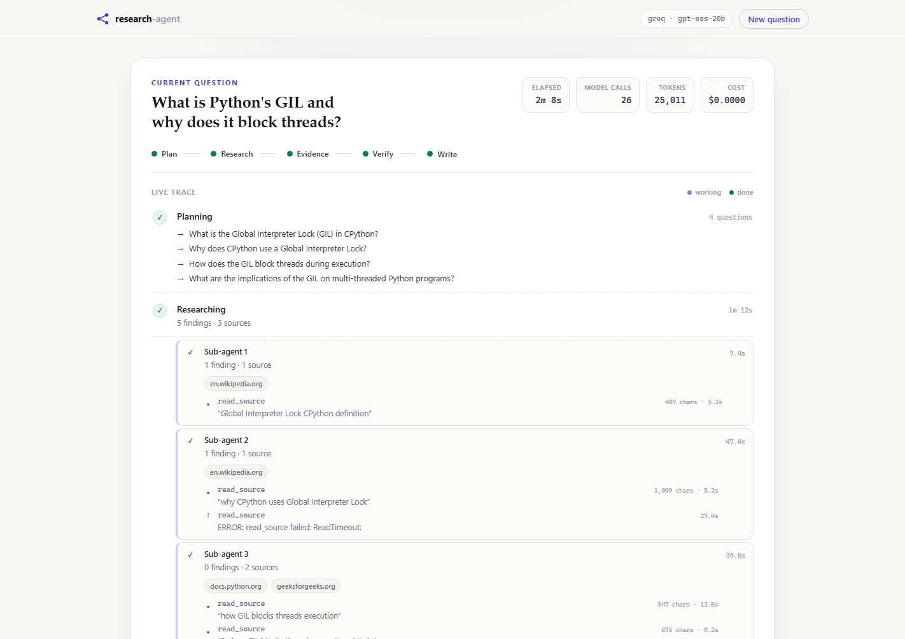
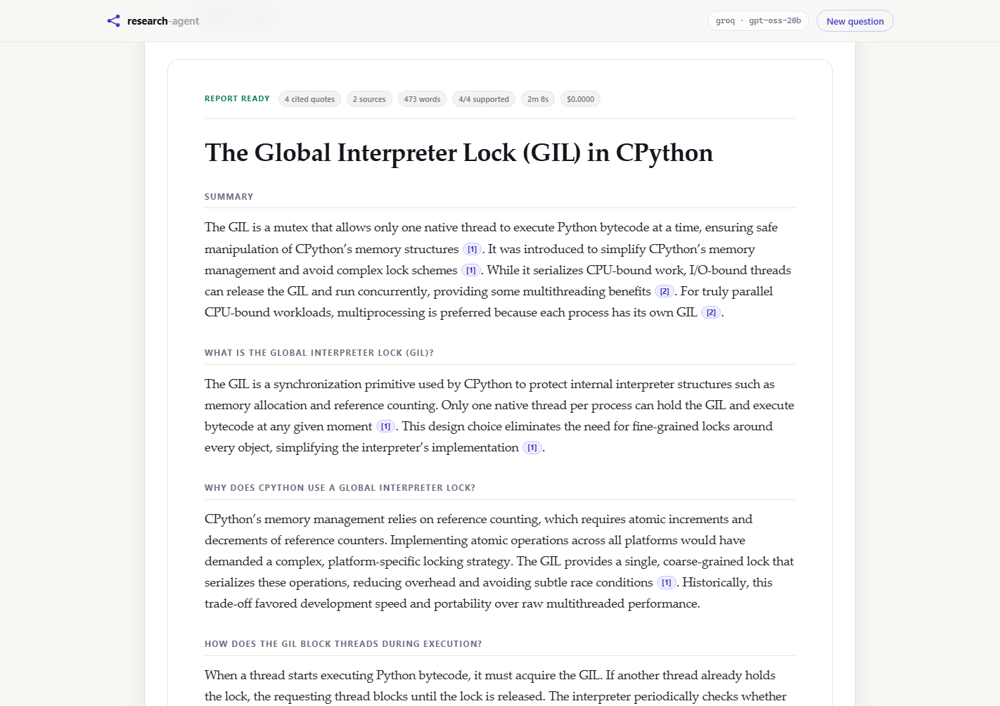
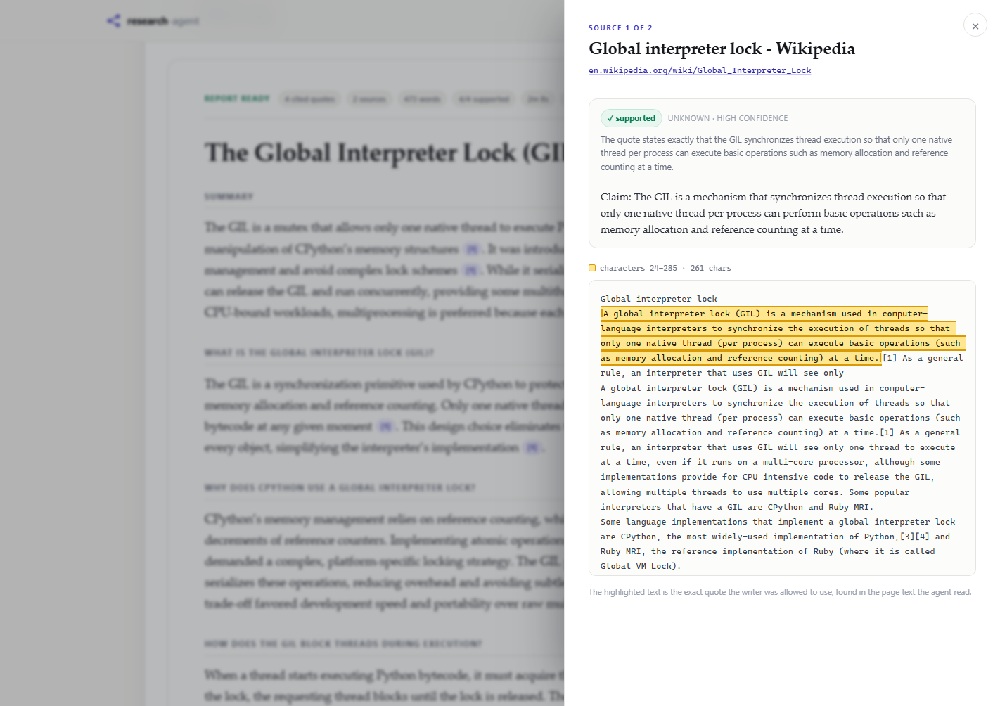

# research-agent

A deep research agent where **every claim is traceable to a source span and machine-checked**.

Provider-agnostic (local Ollama by default), built from scratch — no agent framework.

## Status

| Step | Piece | State |
| --- | --- | --- |
| 1 | LLM provider abstraction + Ollama adapter | done |
| 2 | Agent loop (ReAct) | done |
| 3 | Tool registry (schema from signature + pydantic validation) | done |
| 4 | Real retrieval: search, fetch, extract, cache, SSRF guard | done |
| 5 | Planner (query decomposition) | done |
| 6 | Parallel sub-agents (two-phase reader/extractor) | done |
| 7 | Evidence store (dedupe + span verification) | done |
| 8 | Report writer (citation-closed prose) | done |
| 9 | Claim verifier (support + contradiction scan + trust tiers) | done |
| 10 | Eval harness (30-question set, metrics, artifacts) | done |
| 11 | Tracing + cost (spans, waterfall, token attribution) | done |
| 11b | Live web UI (FastAPI + SSE, citation spotlight) | done |
| 12 | Ablations | next |
| 13 | Packaging + CI | |
| 14 | README with real numbers | |

See [ROADMAP.md](ROADMAP.md) for the full plan.

## Quickstart

```bash
.\venv\Scripts\python.exe -m pip install -r requirements.txt
ollama serve                  # only needed for the local provider
cp .env.example .env          # then set RA_PROVIDER and a key if using a hosted one
.\venv\Scripts\python.exe -m examples.step5_planner
```

## Live web UI

```bash
.\venv\Scripts\python.exe -m web.server
# open http://127.0.0.1:8000
```

Type a question and watch the run stream in: the plan's sub-questions, each
sub-agent's tool calls and sources, evidence and verdict counts, then the
writing stage. Plain HTML/CSS/JS — no build step, no framework, no CDN.



The screenshots are a real run (`openai/gpt-oss-20b`, free tier): 2m 8s,
26 model calls, 25,011 tokens, 4/4 cited claims judged supported, and one
`read_source` tool call that timed out and is shown as an error instead of
being hidden.



Clicking a citation opens the page text the agent actually read and highlights
the stored quote at its exact character offsets:



That interaction is the project thesis. The span was computed when the evidence
was stored; the browser receives `{start, end}` and paints that range. It never
searches the page for the quote, so a wrong span would be visibly wrong instead
of silently plausible.

How it is wired:

* `Tracer` accepts listeners. The SSE endpoint subscribes to span start/end and
  pushes events into a queue, so the UI required no callbacks in planning,
  research, verification or writing.
* Stage spans carry semantic attributes (sub-questions, findings, verdict
  counts, word/citation counts). The timeline renders what the trace already
  records; the UI is a second reader of the same data as `trace.json`.
* One consumer loop with result/error sentinels, so "queue is empty" never
  means "still thinking". A timeout cancels the runner and emits the partial
  trace instead of hanging the browser.
* `create_app(pipeline=...)` accepts a fake pipeline, so the UI's tests run
  offline with no API key.

## Config

All via environment variables (prefix `RA_`) or a local `.env` (gitignored; real
env vars win). `.env.example` documents the minimum.

| Var | Default | Meaning |
| --- | --- | --- |
| `RA_PROVIDER` | `ollama` | `ollama`, `groq`, or `openai` |
| `RA_MODEL` | per provider | model name |
| `RA_JUDGE_MODEL` | per provider | cheaper model for classification calls (support judging); empty = same as `RA_MODEL` |
| `RA_BASE_URL` | per provider | server URL |
| `RA_API_KEY` | – | key for hosted providers |
| `GROQ_API_KEY` | – | used automatically when `RA_PROVIDER=groq` |
| `RA_TEMPERATURE` | `0.2` | sampling temperature |
| `RA_MAX_TOKENS` | provider default | output cap |
| `RA_THINK` | `false` | stream reasoning tokens (Ollama) |
| `RA_NUM_CTX` | `8192` | Ollama context window |
| `RA_CACHE_TTL` | `86400` | seconds a cached page/search stays fresh |
| `RA_TIMEOUT` | `20` | per-request network timeout |
| `RA_PRICE_INPUT` | – | USD per 1M prompt tokens; overrides the built-in price table |
| `RA_PRICE_OUTPUT` | – | USD per 1M completion tokens; must be set with the input price |

## Evals

30 questions across 8 software-engineering categories, run through the full
pipeline (plan → research → verify → write).

```bash
.\venv\Scripts\python.exe -m evals.run --dry-run          # show the dataset
.\venv\Scripts\python.exe -m evals.run --sample 10 --seed 7
.\venv\Scripts\python.exe -m evals.run --all              # the whole set
.\venv\Scripts\python.exe -m evals.compare evals/runs/a/summary.json evals/runs/b/summary.json
```

`evals.compare` exits non-zero when a regression is detected (citation precision
below 1.0, any unsupported citation, or a drop in success/support rate), so it
can gate CI once step 13 wires it up.

### Last run: 10-question sample (`--sample 10 --seed 7`)

| | |
| --- | --- |
| published | 9/10 reports, 0 errors |
| claim support | 61/61 judged (44 supported, 17 partial, 0 unsupported, 0 contradicted, 1 unjudged) |
| citations | 56, every one citable (precision 1.0) |
| citation coverage | 90% of citable evidence used |
| keyword recall | 90% (one report never used the term `Retry-After`) |
| misconception hits | 0 |
| budget | 22,419 tokens and 126 s per question (224,190 total, 21 minutes) |

The tenth report is why the eval exists. It typeset citations with full-width
brackets (`【ev_…】`); the ASCII extractor saw no ids, so it published with zero
machine-readable citations while every check still passed. Citations are now
normalised at the boundary and a draft with no ids is a hard `no_citations`
error, with regression tests on both.

Reported per run:

| Metric | What it means |
| --- | --- |
| success rate | report published, checks passed, at least one citation |
| claim support | share of judged claims the quote actually supports |
| citation precision | **invariant**, micro-averaged over citations, must stay 1.0 |
| citation coverage | share of citable evidence the report used |
| keyword recall | proxy for coverage: expected terms present in the prose |
| misconception hits | known-wrong phrases present, negation-aware |
| tokens / seconds | cost and latency per question |

Rates are macro (per question, then averaged), so one long run cannot hide ten
short failures. Citation precision is the exception — micro-averaged, because a
report that cited nothing has no precision; that failure shows up in success
rate instead. Every run writes `summary.json` and `summary.md`, plus
`report.md`, `evidence.json`, `plan.json`, `trace.json` and `trace.html` per
question under `evals/runs/`.

## Tracing & cost

A report says what the agent concluded. A trace says how it got there. Every run
builds a span tree — `pipeline → plan/research/verify/write → sub-agent → LLM
call or tool` — and writes it twice:

- `trace.json` — the data (one object per span, parent ids, start/duration,
  status, attributes, token usage, cost). Queryable and diffable.
- `trace.html` — a self-contained waterfall (no server, no CDN, no build step)
  with per-stage token tables, per-model cost, the critical path and the slowest
  calls. Double-click it.

Open a trace directly:

```python
from research_agent.pipeline import ResearchPipeline

result = await pipeline.run(question)
if result.trace is not None:
    result.trace.save_html("trace.html")
```

Attribution rules that keep the numbers honest:

- **Tokens are counted once.** Only LLM spans carry usage; stage totals roll up
  their nearest stage. Summing every span would double-count each call.
- **Unknown is not free.** A model missing from `research_agent/pricing.py`
  makes the cost `n/a` and names the model — it never quietly becomes `$0.00`.
  The Groq and Ollama entries are genuinely `0.0` (free tier / local), which is
  a different statement from "we don't know".
- **The critical path is a chain, not a call.** With parallel sub-agents, the
  long pole is root → the child that ends last → its slowest child. That is what
  to optimise; the slowest single call may be sitting off the critical path.

Prices are what *this deployment* pays, not vendor list prices; override them
with `RA_PRICE_INPUT` / `RA_PRICE_OUTPUT` (USD per 1M tokens) when you move to a
paid tier.

## Tests

```bash
.\venv\Scripts\python.exe -m pytest tests -q
```

The suite is deterministic and offline: no API key, no network. The LLM is
replaced by a scripted fake client wherever a model would otherwise be called.
It covers quote location (exact / normalized / fragment / missing), dedupe,
the citable gate, draft checks (including full-width brackets and a draft with
no citations), citation renumbering, failure-to-verdict mapping, the fail-closed
path when a judge call errors, the JSON-mode fallback ladder, metric arithmetic,
the regression gate, per-question timeouts in the eval harness, span nesting
(including concurrent tasks), token attribution without double counting, the
critical path, pricing/override math, and HTML escaping of model output.
